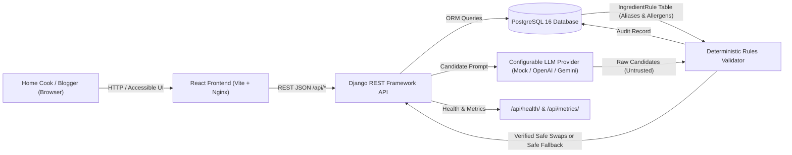
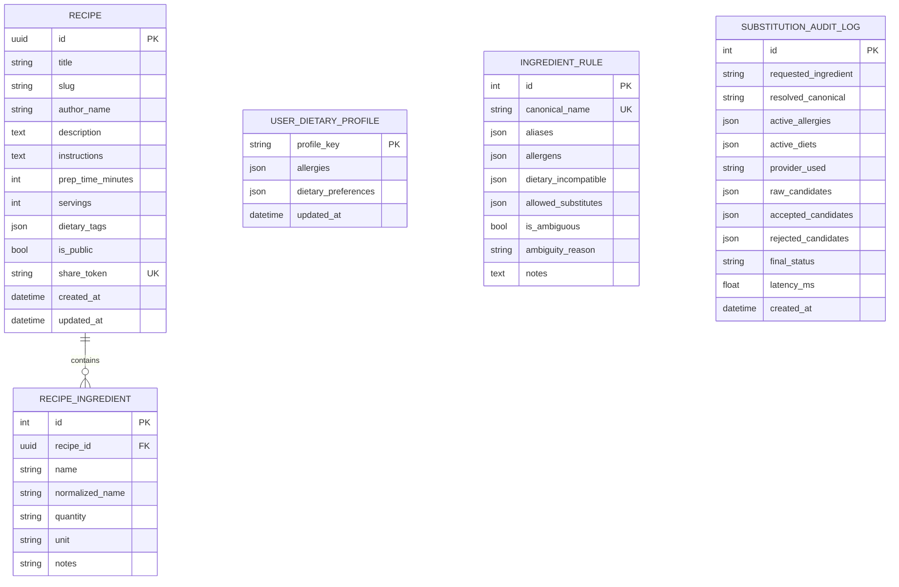
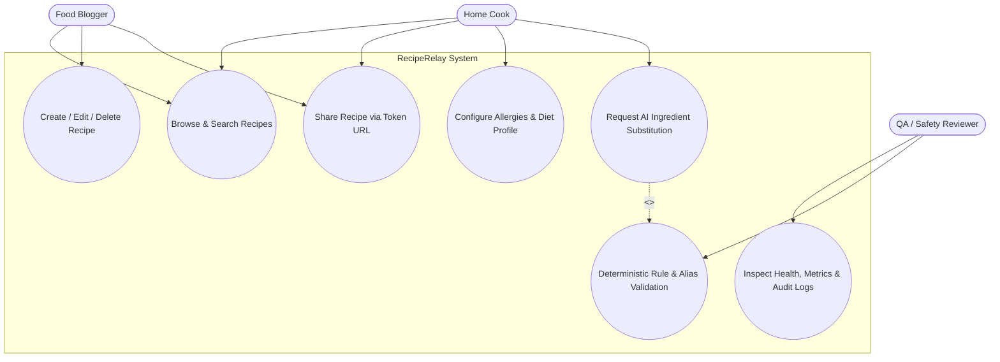

# System Diagrams — RecipeRelay

## 1. System Architecture Diagram



---

## 2. Entity-Relationship (ER) Diagram



---

## 3. Use-Case Diagram



---

## 4. Substitution Validation Sequence Diagram

```mermaid
sequenceDiagram
    actor User
    participant UI as React UI
    participant API as Django /substitutions/suggest/
    participant LLM as LLM Adapter (Mock/API)
    participant Rules as DeterministicRuleValidator
    participant DB as PostgreSQL (IngredientRule)

    User->>UI: Click "Substitute" on ingredient (e.g., butter)
    UI->>API: POST {ingredient, allergies: ["dairy"], dietary_preferences: ["vegan"]}
    API->>LLM: Generate candidate swaps with ratio & rationale
    LLM-->>API: Candidates [ghee, olive oil, coconut oil, mystery spread]
    API->>Rules: validate(ingredient, candidates, allergies, diets)
    Rules->>DB: Lookup canonical rules & aliases
    DB-->>Rules: Rules for butter, ghee (allergen: dairy), olive oil (safe), etc.
    Rules->>Rules: Reject ghee (dairy conflict); Reject mystery spread (no rule)
    Rules-->>API: Accepted [olive oil, coconut oil], Rejected [ghee, mystery spread]
    API->>DB: Save SubstitutionAuditLog
    API-->>UI: 200 OK {ai_assisted: true, status: "verified", suggestions: [...], limitations: "..."}
    UI-->>User: Display verified swaps + AI-assisted badge + disclaimer
```
